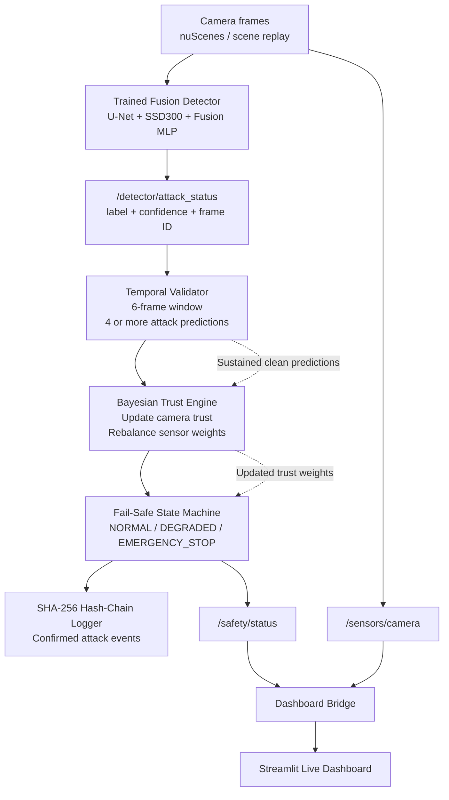
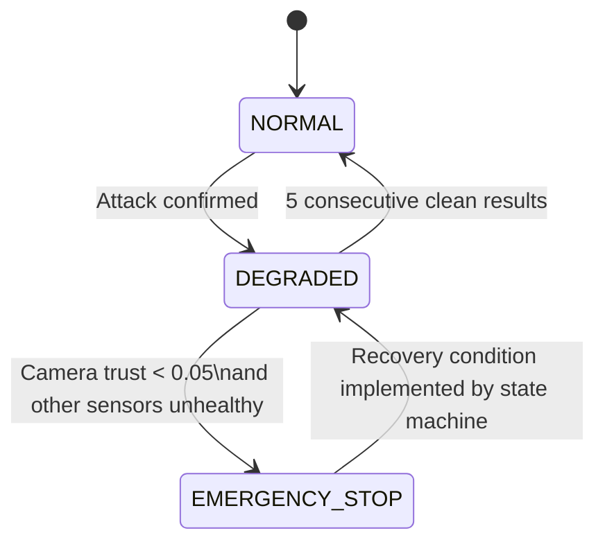

# ROS 2 Safety Mechanism
### Rolling-Shutter Laser Attack Detection, Sensor Trust Management, and Fail-Safe Monitoring

> **Project module:** Safety Mechanism (Objective 2)  
> **Parent project:** ResilientVision-Autonomous  
> **Status:** Integrated demonstration pipeline using a trained U-Net + SSD + Fusion MLP detector, ROS 2, and a Streamlit dashboard.

---

## Overview

The Safety Mechanism is the runtime response layer of the project. It takes the output of the trained camera attack detector and decides how the system should respond when a camera frame may be corrupted by rolling-shutter laser interference.

Rather than reacting to a single potentially noisy prediction, the mechanism checks predictions across multiple consecutive frames, adjusts the camera's trust relative to the other sensors, updates a fail-safe state machine, and records confirmed attack events in a tamper-evident audit log.

The current demonstration is built around ROS 2 and nuScenes camera-frame replay. It includes a live Streamlit dashboard for observing the camera feed, detector output, sensor trust, safety state, and audit history.

### Demo

| Live Dashboard | Demonstration Video |
|---|---|
| **Live link:** <!-- Add your deployed dashboard URL here --> | **Video:** <!-- Add your demo video link or embed here --> |

<!-- Optional video embed:
[](VIDEO_URL)
-->

---

## System Architecture

The mechanism is organized as a sequence of perception, validation, trust management, safety decision, and audit stages.



### Runtime Components

| Component | Responsibility |
|---|---|
| `scene_frame_publisher.py` | Publishes clean nuScenes frames or a mixed clean/attack/recovery demonstration sequence to `/sensors/camera`. |
| `trained_fusion_publisher.py` | Runs the trained U-Net, SSD300, and Fusion MLP on each camera frame and publishes the detector result to `/detector/attack_status`. |
| `safety_integration_node.py` | Connects detector output to temporal validation, trust management, fail-safe decisions, audit logging, and `/safety/status`. |
| `dashboard_bridge.py` | Receives ROS 2 status and camera messages and exposes them through local HTTP endpoints for the dashboard. |
| `live_dashboard.py` | Displays the camera feed, detector confidence, safety state, trust weights, audit events, and scene controls. |

---

## How the Safety Mechanism Works

### 1. Camera Input and Attack Detection

The camera publisher sends frames to the ROS 2 topic:

```text
/sensors/camera
```

The trained detector subscribes to this topic. It uses three components:

- **U-Net:** Produces a segmentation probability map and extracts information about potentially affected image regions.
- **SSD300 (VGG16 backbone):** Extracts object-detection confidence information.
- **Fusion MLP:** Combines five U-Net features and five SSD features into a 10-dimensional feature vector and predicts the binary class.

The detector classifies each frame as:

| Label | Meaning |
|---|---|
| `0` | Clean |
| `1` | Corrupt / attack detected |

The detector publishes a JSON message on:

```text
/detector/attack_status
```

The message contains the frame ID, predicted label, confidence, and timestamp.

### 2. Temporal Validation

A single incorrect prediction should not immediately trigger a safety response. The temporal validator therefore checks a rolling window of the latest **six frame predictions**.

- It stores the recent clean/corrupt labels.
- An attack is confirmed when **at least four of the last six predictions** indicate an attack.
- This reduces the effect of isolated false positives and short-lived prediction noise.

The temporal validator provides the confirmed attack decision used by the safety state machine.

### 3. Bayesian Sensor Trust Management

The trust engine maintains relative trust weights for the available sensor modalities:

| Sensor | Initial Weight |
|---|---:|
| Camera | 0.40 |
| LiDAR | 0.25 |
| Radar | 0.20 |
| IMU | 0.15 |

When the detector reports a potentially corrupted camera frame, the trust engine updates camera trust using the detector label and confidence. The sensor weights are then normalized.

The purpose is to reduce reliance on a camera that may be compromised and represent the relative contribution of the other sensor modalities.

As clean predictions continue, camera trust can recover gradually rather than being restored immediately.

> **Scope note:** The current demonstration uses camera-frame replay and trust-weight logic. It does not claim that live LiDAR, Radar, and IMU health measurements are being acquired and fused in this demo.

### 4. Fail-Safe State Machine

The fail-safe state machine uses three states:

| State | Meaning |
|---|---|
| `NORMAL` | No confirmed camera attack is currently active. |
| `DEGRADED` | A camera attack has been temporally confirmed; the system moves into a more cautious state. |
| `EMERGENCY_STOP` | A more severe safety condition is met, based on very low camera trust and the health status of other sensors. |

**Main transitions:**



The state machine uses temporal confirmation and trust information rather than changing state based on one raw detector prediction.

**Current demo limitation:** `other_sensors_healthy` is currently configured as `True` by default because live health telemetry from LiDAR, Radar, and IMU is not integrated into this demonstration. Therefore, the emergency-stop transition is not expected to trigger under the default configuration. This is a software demonstration state, not a hardware emergency-stop circuit.

### 5. Tamper-Evident Audit Logging

When an attack changes from unconfirmed to confirmed, the integration node records an audit event.

The hash-chain logger stores records in JSON Lines format. Each entry includes a SHA-256 hash linked to the previous entry.

This makes changes to earlier records detectable because modifying a record breaks the subsequent hash chain.

The audit trail supports traceability of confirmed attack events and safety decisions.

---

## ROS 2 Communication

The main topics used by the integrated pipeline are:

| Topic | Message Type | Purpose |
|---|---|---|
| `/sensors/camera` | `sensor_msgs/msg/Image` | Camera frames supplied to the detector. |
| `/detector/attack_status` | `std_msgs/msg/String` | JSON detector output containing frame ID, label, confidence, and timestamp. |
| `/safety/status` | `std_msgs/msg/String` | JSON safety status containing attack confirmation, camera trust, trust weights, safety state, and audit information. |
| `/camera/mode` | `std_msgs/msg/String` | Selects the clean scene or attack demonstration sequence. |
| `/camera/control` | `std_msgs/msg/String` | Starts or stops scene playback. |

---

## Dashboard

The Streamlit dashboard provides a visual interface for monitoring the running pipeline.

### Dashboard Features

- Live camera frame display.
- Detector prediction and confidence.
- Temporal attack-confirmation status.
- Current safety state.
- Camera, LiDAR, Radar, and IMU trust-weight visualization.
- Audit-event history.
- Scene selection:
  - **Normal nuScenes:** Replays clean frames.
  - **Attack Demo:** Replays a sequence containing clean frames, attack frames, and recovery periods.
- Playback controls:
  - Start scene.
  - Stop scene.

The dashboard communicates with the ROS 2 system through `dashboard_bridge.py`. The bridge exposes HTTP endpoints used by the Streamlit frontend.

---

## Running the Integrated Demonstration

### Prerequisites

- Ubuntu / WSL environment.
- ROS 2 Jazzy.
- Python virtual environment with the project dependencies installed.
- Trained model checkpoints and metadata.
- nuScenes data or the prepared demonstration frames.

### Start the Backend

From the project root:

```bash
cd ~/capstone-project
source ~/ros_env/bin/activate
source /opt/ros/jazzy/setup.bash
./start_backend.sh
```

The backend startup script launches the four ROS 2 processes:

1. `dashboard_bridge.py`
2. `trained_fusion_publisher.py`
3. `safety_integration_node.py`
4. `scene_frame_publisher.py`

Check the active ROS 2 nodes:

```bash
ros2 node list
```

### Start the Dashboard

In another terminal:

```bash
cd ~/capstone-project
source ~/ros_env/bin/activate
source /opt/ros/jazzy/setup.bash
./start_dashboard.sh
```

Open the dashboard in a browser:

```text
http://localhost:8501
```

To access it from another device on the same local network, use the host PC's LAN IP address and port `8501`, after configuring the required WSL networking and firewall rules:

```text
http://<HOST-PC-LAN-IP>:8501
```

The host PC and backend processes must remain running while the dashboard is in use.

### Stop the Backend

From the project root:

```bash
./stop_backend.sh
```

Stop the Streamlit dashboard separately with `Ctrl+C` in its terminal.

---

## Model Evaluation Reference

The detector's independent external evaluation was performed on 2,400 images generated using a separate Köhler rolling-shutter attack engine. The model was evaluated without retraining, fine-tuning, or refitting the feature scaler on that external dataset.

| Metric | External Evaluation |
|---|---:|
| Accuracy | 82.50% |
| Precision | 79.28% |
| Recall | 88.00% |
| F1-score | 83.41% |
| Specificity | 77.00% |
| ROC-AUC | 90.66% |

These are **detector evaluation results**, not end-to-end safety-system accuracy figures. The independent evaluation indicates a domain gap between the simulated training data and the external attack data; further testing is needed across additional attack conditions and real camera environments.

---

## Design Considerations and Limitations

- The current pipeline is a research and demonstration prototype, not a certified automotive or functional-safety system.
- The emergency-stop state in the software state machine is not equivalent to a physical emergency-stop circuit or safety-rated actuator shutdown.
- Live LiDAR, Radar, and IMU health telemetry is not currently integrated into the demonstration's emergency-stop decision.
- The camera attack detector has demonstrated promising independent evaluation results, but it can still produce false positives and false negatives.
- The demonstration uses replayed nuScenes frames and generated attack sequences; this is not equivalent to validation on a real vehicle under real laser exposure.
- The dashboard is a monitoring and demonstration interface. It is not itself a safety controller.

---

## Technologies Used

- Python
- ROS 2 Jazzy
- PyTorch
- Torchvision
- U-Net
- SSD300 with VGG16
- Feature-fusion MLP
- OpenCV
- NumPy
- Streamlit
- HTTP / JSON
- SHA-256 hash chaining
- nuScenes

---

## Future Improvements

- Integrate live LiDAR, Radar, and IMU health/status telemetry.
- Validate sensor-trust updates using real multi-sensor measurements.
- Expand testing to unseen attack frequencies, intensities, and camera settings.
- Improve detector specificity while preserving attack recall.
- Add hardware-level safety mechanisms and independently validated stop interfaces.
- Test the complete pipeline on real camera hardware and a representative vehicle platform.

---

## Acknowledgements

This safety mechanism builds on the rolling-shutter laser attack detection work in the parent project, **ResilientVision-Autonomous**. The detector and safety-response layer are documented separately to make their responsibilities, evaluation, and limitations clear.
